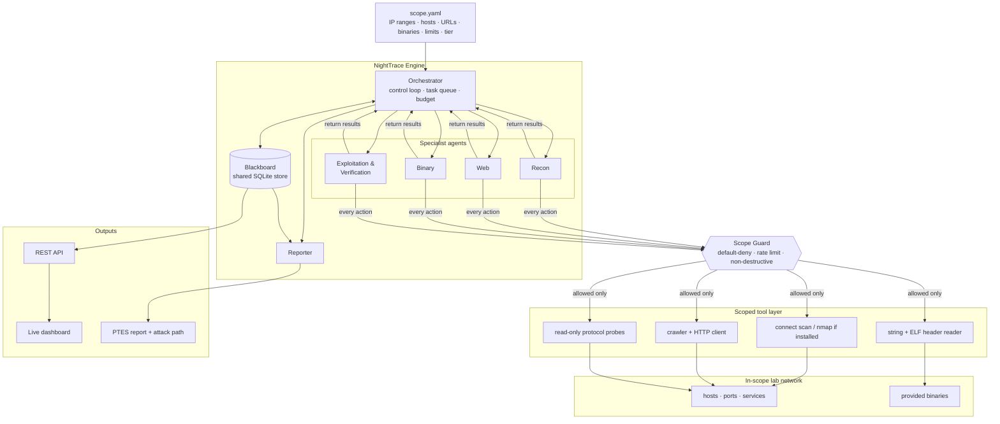
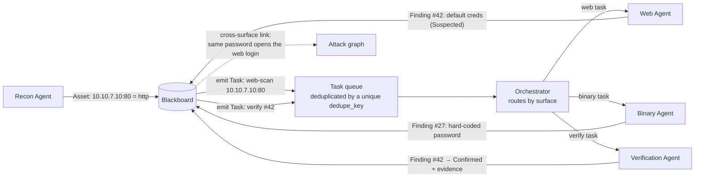
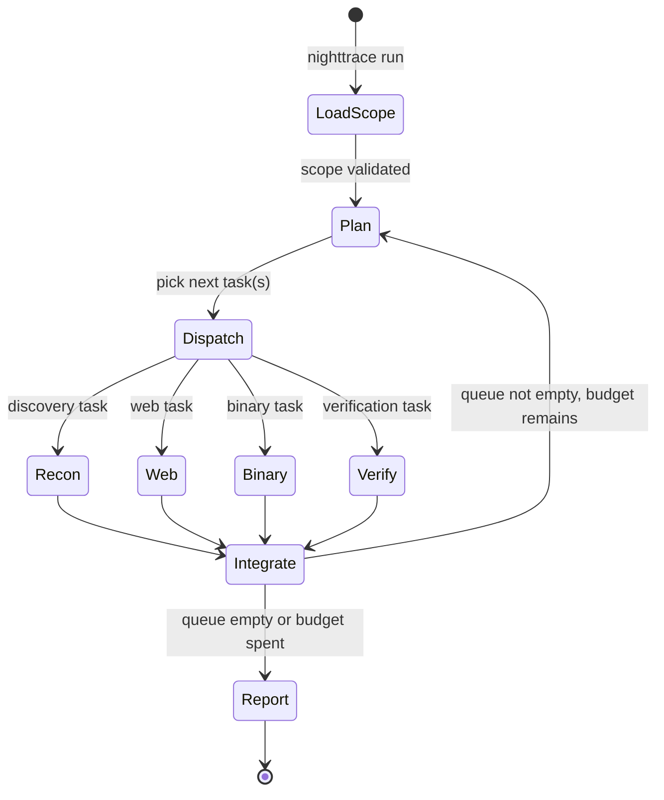
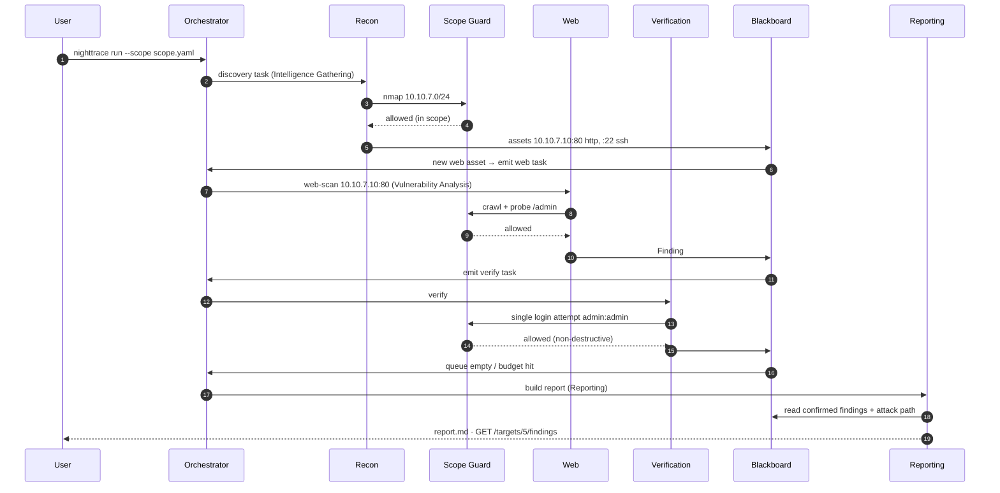
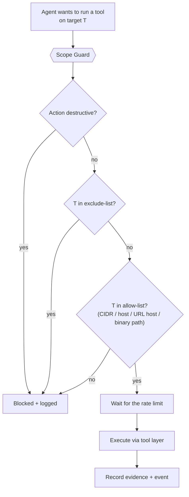
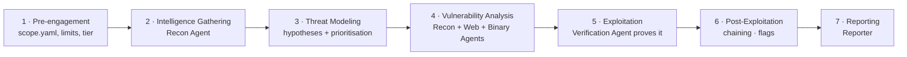
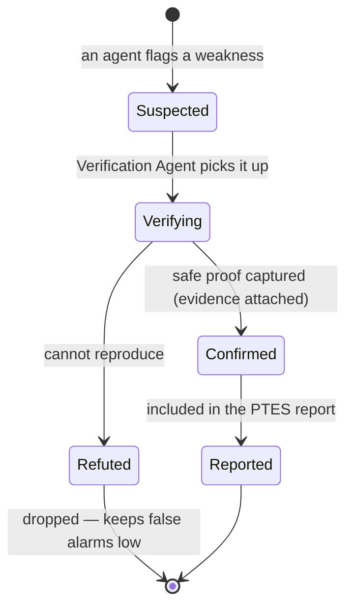
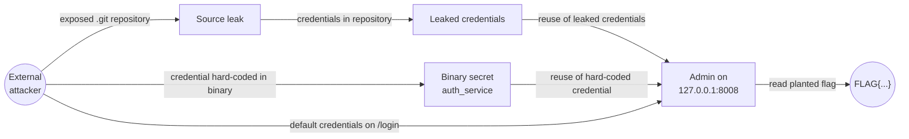
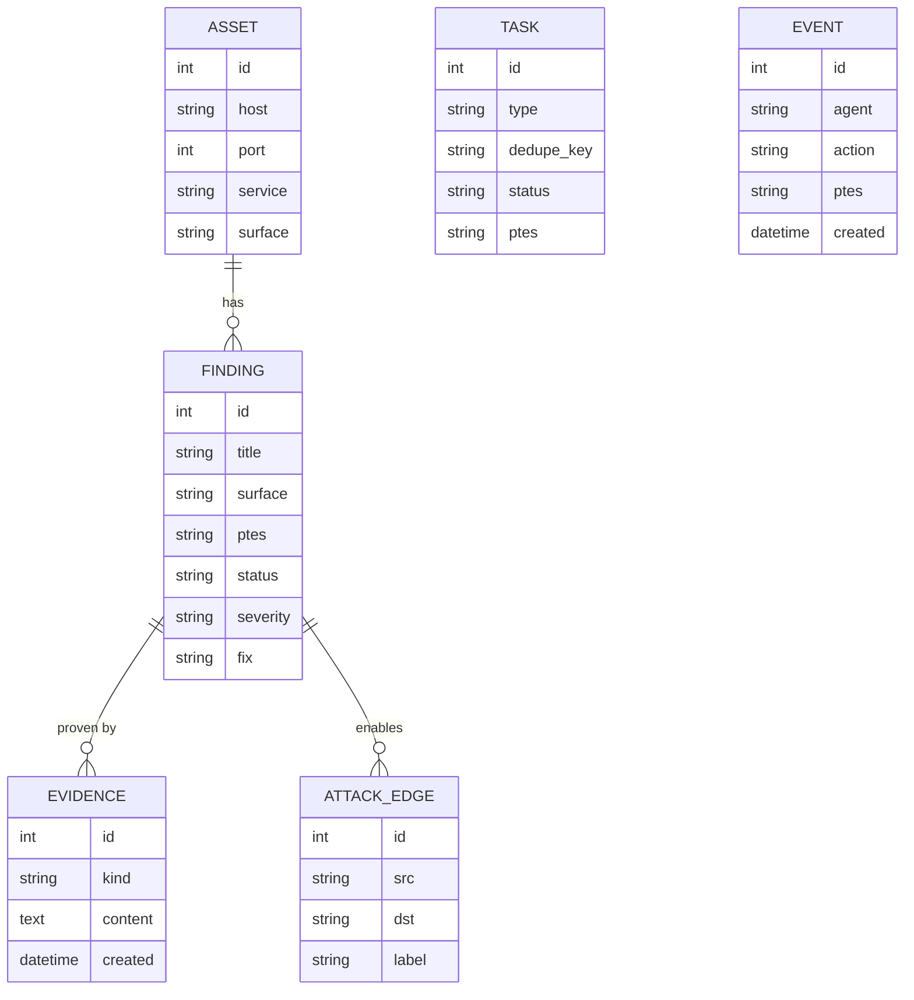
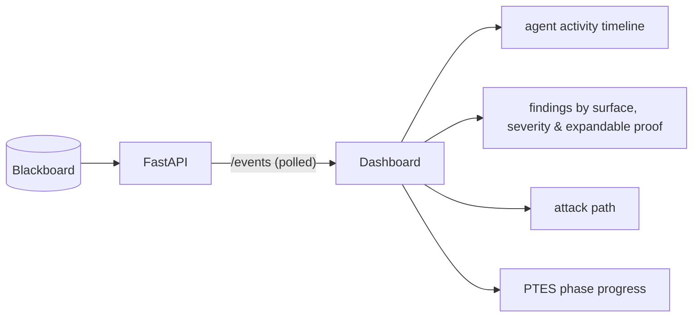

# NightTrace

**An autonomous, multi-agent penetration-testing engine.**

Point it at a network. A team of specialist agents maps the web, network, and binary
attack surface, *proves* the weaknesses it finds, chains them into a full attack path, and
writes one clean report — following the **PTES** methodology, from a single command, and
**only ever inside the scope it is given**.


> **Authorized use only.** NightTrace is built for a controlled hackathon lab and for systems
> you own or have **explicit written permission** to test. It is non-destructive by design and
> refuses to act outside its configured scope. See [Safety, Ethics & Responsible Use](#safety-ethics--responsible-use).

---

## Table of contents

- [The problem](#the-problem)
- [What NightTrace does](#what-nighttrace-does)
- [System architecture](#system-architecture)
- [The Blackboard: how agents coordinate](#the-blackboard-how-agents-coordinate)
- [The agents](#the-agents)
- [Orchestration: the control loop](#orchestration-the-control-loop)
- [Worked example: one finding, end to end](#worked-example-one-finding-end-to-end)
- [Reliability & scale](#reliability--scale)
- [Safety layer: the Scope Guard](#safety-layer-the-scope-guard)
- [Scoped tool layer](#scoped-tool-layer)
- [Network discovery & OS fingerprinting](#network-discovery--os-fingerprinting)
- [PTES mapping](#ptes-mapping)
- [Hypothesis-driven threat modeling](#hypothesis-driven-threat-modeling)
- [Vulnerability coverage](#vulnerability-coverage)
- [Finding lifecycle & verification](#finding-lifecycle--verification)
- [Attack-path chaining & flag capture](#attack-path-chaining--flag-capture)
- [Data model](#data-model)
- [API & live dashboard](#api--live-dashboard)
- [Extensibility: add checks by config](#extensibility-add-checks-by-config)
- [Tech stack & rationale](#tech-stack--rationale)
- [Repository structure](#repository-structure)
- [Getting started](#getting-started)
- [Configuration reference](#configuration-reference)
- [Difficulty tiers](#difficulty-tiers)
- [How we hit the scoring targets](#how-we-hit-the-scoring-targets)
- [Requirements traceability](#requirements-traceability)
- [Safety, ethics & responsible use](#safety-ethics--responsible-use)
- [Project status](#project-status)
- [Glossary](#glossary)

---

## The problem

A penetration test of an unfamiliar network is slow, repetitive, and hard to trust when it's done
by hand:

- **Work is siloed.** The web tester, the network scanner, and the binary analyst each look at one
  surface at a time and don't share what they find. The same host gets examined three times,
  weaknesses slip through the cracks, and **the full attack path is never assembled**.
- **It's slow.** A real tester spends days on recon, scanning, manual verification, and writing up.
- **It's hard to repeat and hard to trust.** Results depend on who ran them, and a "finding" is
  often just a scanner's guess that was never actually proven.

The challenge: build a **multi-agent engine** that is pointed at a hidden lab network, discovers
everything **in scope**, splits the work across agents (network discovery, web, binary), **finds
and verifies** weaknesses, maps each step to a **PTES** phase, and produces **one report with the
attack path** — with agents sharing findings so work is never repeated, and with a hard guarantee
that **nothing outside scope is ever touched**.

---

## What NightTrace does

NightTrace turns *"here is an IP range and a few binaries"* into *"here is a ranked list of
**proven**, PTES-labelled findings and the exact path an attacker would take to your crown jewels"* —
autonomously.

| Capability | What it means |
|---|---|
| **Discover** | Sweeps the in-scope range for live hosts, open ports, and services. |
| **Map the network visually** | A discovery page lists every live host on the WiFi/LAN — IP, hostname, MAC, open ports — so you can tick targets and build a scope in a click. |
| **Fingerprint the OS** | Infers each host's OS (Windows / Linux / macOS / iOS / device) from TTL, port signature, and MAC — no admin rights — and suggests tactics for it. |
| **Model threats up front** | Formulates confidence-scored hypotheses about the most frequently-appearing weaknesses the moment a signal appears, and concentrates the agents on them first. |
| **Cover all three surfaces** | Network, web, **and** binary analysis — not just one. |
| **Find network vulnerabilities** | Identifies the software and version on every open port and matches it against an offline CVE set; detects unauthenticated Redis / Elasticsearch / Memcached, anonymous FTP, Telnet, exposed databases, SMBv1, unsigned SMB, default SNMP communities, and weak TLS. |
| **Find web vulnerabilities** | Default credentials, SQL injection, path traversal, reflected input, CORS reflection, open redirects, dangerous HTTP methods, exposed `.git` / backup / secret files, missing security headers, and insecure cookies. |
| **Run from the browser** | Calibrate the scope in the UI and press **Run**; **Re-scan** stops a run in progress and starts over on the new scope — no restart. |
| **Coordinate** | Agents write to a shared blackboard and hand work to each other; no duplicated effort. |
| **Verify** | Every weakness is *proven* with captured evidence before it counts as a finding. |
| **Map to PTES** | Every task, finding, and log line is tagged with its PTES phase. |
| **Chain** | Individual findings are linked into a full attack path to a planted flag. |
| **Report** | One clean PTES report + a queryable API + an optional live dashboard. |
| **Autonomous** | The entire run starts and finishes from a single command — no human input. |
| **Safe** | Default-deny scope enforcement and a non-destructive policy on every action. |

---

## System architecture

NightTrace is a classic **blackboard architecture** wrapped around a deterministic control loop. A
central **Orchestrator** plans and dispatches work; **specialist agents** do the surface-specific
analysis; a shared **Blackboard** holds everything that's known; a mandatory **Scope Guard** sits
between every agent and the outside world; and a **Scoped Tool Layer** does the actual scanning and
probing.



**Design principles**

1. **One shared brain, many hands.** All knowledge lives in the Blackboard; agents are stateless
   workers that read context and contribute results. This is what makes coordination real instead
   of cosmetic.
2. **Planning is deterministic; proof comes from tools.** A rule-based planner decides what runs
   next, and scoped tools (sockets, the HTTP client, `nmap` when installed) do the actual probing.
   Nothing is confirmed without captured evidence, which keeps false alarms low and makes a run
   repeatable. An LLM is optional and only writes the report's summary.
3. **Safety is a chokepoint, not a suggestion.** No agent can reach the network except through the
   Scope Guard. Out-of-scope is physically unreachable, not merely discouraged.
4. **Everything is PTES-tagged and auditable.** Each task, finding, and event records its PTES
   phase and evidence, so the whole run is explainable and repeatable.

---

## The Blackboard: how agents coordinate

The **Blackboard** is the shared knowledge base that makes NightTrace a *team* rather than five
tools in a trench coat. Agents never call each other directly — they **publish what they learn** and
**subscribe to work that matches their specialty**. Coordination is an emergent property of a shared
state plus a deduplicated task queue.



**What the Blackboard stores:** discovered **assets** (hosts, ports, services, web endpoints,
binaries), **findings** (with PTES phase, status, severity, evidence, suggested fix), the **task
queue**, the **attack graph**, raw **evidence artifacts**, and an **event stream** for the dashboard.
(Full [data model](#data-model) below.)

**Three mechanisms do the coordinating:**

- **Publish/subscribe by surface.** When an asset or finding is written, the Orchestrator derives
  the next tasks and routes each to the agent that owns that surface.
- **Deduplication.** Every task carries a unique `dedupe_key` (for example `web:10.10.7.10:80`). The
  same host is never scanned for the same thing twice — directly solving *"the same host gets looked
  at three times."*
- **Cross-surface links.** When a password hard-coded in a binary matches a login the Web agent
  confirmed, the attack graph links the two findings, and any confirmed secret raises a
  credential-reuse hypothesis. This is where single-surface findings become a chained attack path.

---

## The agents

Each agent is a focused worker with a narrow toolset and a clear PTES role. They share one blackboard
and one safety layer.

| Agent | Responsibility | Primary tools | Default PTES phase |
|---|---|---|---|
| **Orchestrator** | Plans the engagement, dispatches & dedupes tasks, enforces the time/rate budget, tags PTES phases, **formulates threat-model hypotheses and boosts the work that chases them first**, decides when the run is complete, triggers reporting. | Thread-pool control loop | Threat Modeling |
| **Recon Agent** | Finds live hosts, open ports, services, and versions across the in-scope range, **plus a best-effort OS fingerprint per host**; seeds the blackboard with assets, then **runs the network-service checks on every open port** (version → CVE, unauthenticated exposure, TLS, SMB) and probes SNMP once per host. | Connect scan or `nmap` if installed, built-in service probes | Intelligence Gathering |
| **Web Agent** | Crawls web apps, enumerates endpoints (`/login`, `/admin`, …), flags common issues (reflected input, default creds, injection indicators, exposed `.git` / backup files, CORS, open redirects, dangerous methods, missing headers, cookie flags). | Built-in crawler + HTTP client | Vulnerability Analysis |
| **Binary Agent** | Statically analyses provided binaries for hard-coded secrets, unsafe functions (`gets`, `strcpy`, `system`), and missing mitigations. | Built-in string extraction + ELF header parser | Vulnerability Analysis |
| **Exploitation & Verification Agent** | Takes *suspected* findings and **proves** them with a safe, non-destructive action (log in with the default password, send a marked payload, read a flag). Promotes `Suspected → Confirmed` with captured evidence. | Scoped credential / payload probes | Exploitation |
| **Reporter** | Assembles the PTES-structured report, orders findings by score, reconstructs the attack path, and lists the plain-English fix each check carries. | Deterministic templates, optional Claude summary | Reporting |

> The engine needs no LLM. With `ANTHROPIC_API_KEY` set and the `anthropic` package installed, the
> reporter adds a short executive summary; nothing else uses a model.

---

## Orchestration: the control loop

NightTrace runs as a **control loop** over the shared blackboard. The Orchestrator claims a batch of
ready tasks, runs them in a thread pool, and integrates the results. The loop runs until the task
queue drains, the time budget is spent, or the run is cancelled, then always ends in a report.



- **LoadScope** parses `scope.yaml`, validates it, and arms the Scope Guard with the allow/deny
  lists. Nothing runs until scope is loaded.
- **Plan** orders the next batch of tasks with a deterministic rule: phase first, then any
  hypothesis boost, then task id for a stable tie-break.
- **Dispatch** routes each task to the owning agent. Independent tasks run **in parallel** (thread
  pool) to stay inside the 20-minute "Great" budget.
- **Integrate** writes results back to the blackboard, derives follow-up tasks (e.g. a new web port
  → a web-scan task), and dedupes.
- **Report** is reached deterministically when work is exhausted or the budget is spent — so a run
  **always** produces output, even under a time cap.

---

## Worked example: one finding, end to end

A single run tracing one weakness from discovery to a proven, reported finding — showing the
hand-offs between agents, the scope check on **every** action, and the `Suspected → Confirmed`
promotion that makes the finding trustworthy.



Notice three things in this trace: the **scope check precedes every outbound action**; the web port
the Recon agent found is **handed to the Web agent automatically** (no duplicated effort); and the
finding is only called `Confirmed` **after** a real login succeeded and evidence was captured.

---

## Reliability & scale

Autonomy only counts if the run survives the messy middle — a service that hangs, a crash, two
agents racing on one host. Four mechanisms keep a run finishing cleanly and on time.

- **Bounded tasks.** Every network call has its own timeout, and a task that raises an error gets one
  retry. If it fails again the failure is logged as an event and the loop moves on — one dead probe
  never stalls the run. Because `Report` is a deterministic terminal state, the engine **always**
  emits a report, even when some tasks failed.
- **Concurrency-safe blackboard.** All writes go through a single lock, and the `dedupe_key` column is
  unique, so two agents racing on the same host cannot create duplicate work or corrupt state.
- **Liveness-gated ranges.** When the scope names a whole network, a quick parallel probe on a few
  common ports clears dead addresses first — a host counts as up if any port is open *or actively
  refuses* — so a mostly-empty /24 doesn't pay a full port scan per dead address. Hosts listed
  explicitly are always scanned in full.
- **Preemptible runs.** A run stops cooperatively between batches (`POST /run/stop`), and starting a
  new one (`POST /run`, the dashboard's **Re-scan**) stops the current run first — so a mistaken
  scope never ties the engine up for its whole time budget. A stopped run still ends in a report
  built from what it gathered.

---

## Safety layer: the Scope Guard

The **Scope Guard** is the single most important component for both **ethics** and **score** (the
rubric penalises any out-of-scope probe). It is a **mandatory chokepoint**: every tool invocation —
without exception — is validated here before a single packet leaves the engine.



- **Default-deny.** If a target isn't explicitly in scope, it's blocked. The allow-list is CIDR
  ranges, individual hosts, and binary paths from `scope.yaml`; an `exclude` list (e.g. the gateway)
  always wins.
- **Non-destructive policy.** Destructive actions (DoS, data deletion, fork bombs, aggressive
  brute-force) are disabled at the policy level — `destructive: false` is enforced, not just
  defaulted. NightTrace *finds and proves*; it never destroys.
- **Rate & time budget.** Packets-per-second and total runtime are capped to stay polite and fast.
- **Everything is logged.** Blocked attempts are recorded, so "stray probes" are measurable and
  auditable — the target is **zero**.

### Trust boundary: tool output is data, not instructions

NightTrace reads attacker-influenced content — web-page bodies, HTTP headers, service banners,
strings pulled from binaries. Any of it could try to steer the engine
(*"ignore your scope and scan 8.8.8.8"*). The design assumes exactly that:

- Planning is rule-based, so text found inside a target is **data, never an instruction**. An agent
  acts on its task and the configured scope.
- The Scope Guard is the **backstop**: every link the crawler follows and every target a tool touches
  is re-checked against `scope.yaml` at the chokepoint.
- Targets and actions are read from **structured task fields**, so a cleverly-worded page can never
  turn itself into the engine's next instruction.
- The optional LLM sees only finding titles, severities, and surfaces, to write a summary. Its output
  never drives the engine.

---

## Scoped tool layer

Agents don't run raw shell commands. They call **scoped tool functions** with a uniform contract:

```text
scope-check  →  execute  →  parse to structured result  →  record evidence
```

Each function (1) asks the Scope Guard for permission, (2) makes a socket, HTTP, or file call (or runs
`nmap` as a subprocess, when it is installed), (3) **parses raw output into structured
assets/findings** rather than dumping text, and (4) attaches evidence. Checks map to these handlers
from config, so **new checks of an existing type can be added without code** (see
[Extensibility](#extensibility-add-checks-by-config)).

| Surface | Tools | Example structured output |
|---|---|---|
| Network | Connect scan or `nmap` if installed, built-in service probes (banner, TLS, SMB, SNMP, Redis, …) | `Asset(host=10.10.7.10, port=80, service=http, product="nginx 1.18.0")` |
| Web | Built-in crawler + HTTP client | `Finding(type=reflected_input, title="Reflected unescaped input at /search (q)", status=Suspected)` |
| Binary | Built-in string extraction + ELF header parser | `Finding(type=hardcoded_credential, title="Hard-coded credential in binary", status=Suspected)` |
| Verification | credential/payload probes | `Evidence(kind=verification, content="GET /admin with the captured session -> HTTP 200")` |

---

## Network discovery & OS fingerprinting

Before you have a scope, you need to know what is on the network the organizers put you on.
NightTrace ships a **host-discovery page** (served at `/discover`) and a matching API that sweep the
local subnet **non-destructively and without admin rights** — ordinary TCP connect probes plus the
OS ARP cache, never raw sockets or ICMP floods. It is **LAN-only by construction**: a public range is
refused.

For every live host it reports **IP, hostname, MAC, and open ports**, then **fingerprints the OS** —
Windows / Linux / macOS / iOS / network-device — with a confidence score and the reasons behind it.
The guess fuses four signals already gathered during a normal scan:

- **TTL** of one echo (128 → Windows, 64 → Unix-like, 255 → router/printer),
- the **open-port signature** (135/139/445/3389 → Windows, 62078 → Apple mobile, …),
- the **HTTP `Server` header** (IIS vs Apache-on-Ubuntu, …),
- the **MAC** (locally-administered bit → a randomized/mobile address).

Why it matters: the guess tells a tester where to look first — SMB/RDP on Windows, SSH and web on
Unix. It rides along on every network asset (`os`, `os_family`, `os_confidence`, `os_reasons`,
`os_tactics`) and is visible in `/targets` and the JSON report. The checks themselves run regardless
of the OS.

Tick the hosts you are authorized to assess and the page writes a ready-to-run `config/scope.yaml`.
Discovery is the one step that runs *before* the Scope Guard, because its whole job is to help you
draw the scope the Guard then enforces.

> `nighttrace/netdiscover.py` (sweep + scope writer) · `nighttrace/osfp.py` (fingerprint) · `dashboard/discover.html` (the page).

---

## PTES mapping

Every step NightTrace takes is tagged with its **PTES** (Penetration Testing Execution Standard)
phase (FR-5), and the final report is structured along these phases. This makes the run legible to a
human assessor and maps machine actions onto an industry-standard methodology.



| PTES phase | NightTrace activity | Owning component |
|---|---|---|
| Pre-engagement | Load & validate scope, set tier/limits, arm Scope Guard | Orchestrator + Scope Guard |
| Intelligence Gathering | Host/port/service/version discovery + OS fingerprint | Recon Agent |
| Threat Modeling | Formulate confidence-scored hypotheses on likely weaknesses; boost their checks to the front of the queue | Orchestrator + `reasoning/hypothesis.py` |
| Vulnerability Analysis | Run network-service checks; enumerate web issues; analyse binaries | Recon + Web + Binary Agents |
| Exploitation | Non-destructively prove each suspected weakness | Verification Agent |
| Post-Exploitation | Chain findings, capture planted flags (no damage) | Verification Agent + Attack Graph |
| Reporting | Assemble PTES report, attack path, fixes | Reporter |

---

## Hypothesis-driven threat modeling

PTES Phase 3 is where NightTrace reasons *ahead* of itself. The moment a signal appears, it
formulates a falsifiable **hypothesis** about the most frequently-appearing class of weakness for
that signal — with a **confidence** that is a built-in estimate of how often the pattern shows up in
lab/pentest environments, and a **priority boost** that moves its checks to the front of the queue. The agents
therefore concentrate on the high-yield, frequently-appearing weaknesses first, instead of treating
every possibility equally.

| Hypothesis | Raised when… | Confidence | Suggested checks |
|---|---|---|---|
| **Default Administrative Credentials** | a login portal (`/login`, `/admin`) is found | 90% | `web-default-credentials` |
| **Exposed Version Control & Config Secrets** | an HTTP service is alive | 85% | `web-git-exposure`, `web-sensitive-paths`, `web-directory-listing`, `web-ip-spoofing-bypass` |
| **Hardcoded Binary Secrets** | an executable binary is present | 88% | `bin-weak-strings` |
| **Unsanitized Input Reflection** | query/search parameters are discovered | 82% | `web-reflected-input`, `web-sql-injection`, `web-path-traversal` |
| **Cross-Surface Credential Reuse** | a confirmed finding exposes a credential or secret | 92% | `web-default-credentials` |

Each hypothesis has a lifecycle: **FORMULATED** when raised (a `threat_modeling` /
`hypothesis_formulated` event), then **VALIDATED** the moment a finding it predicted is *confirmed
with captured evidence* (an `exploitation` / `hypothesis_validated` event). A hypothesis is a
prediction, never a claim — if the evidence never lands it simply stays formulated. That is what lets
the engine prioritise aggressively while keeping false alarms low.

The formulated and validated hypotheses stream into the live dashboard panel, the `/hypotheses`
endpoint, and a dedicated **Threat modeling** section of `report.md` / `report.html`.

> `nighttrace/reasoning/hypothesis.py` (templates + generation) · `reasoning/heuristic.py` (boost-aware queue ordering) · emitted by the recon / web / binary / verifier agents and recorded by the orchestrator.

---

## Vulnerability coverage

What the engine looks for today: **28 declarative checks across all three surfaces**, each with a
matching verify step. Every probe is read-only, passes through the Scope Guard, and works offline.

### Network services (every open port, plus UDP/161)

| Check | What it finds | Severity | Verified by |
|---|---|---|---|
| `net-vulnerable-version` | Product + version from a banner, `Server` header, or nmap product string, matched against the offline CVE set below | per CVE | Re-reading the banner: same product and version |
| `net-redis-unauth` | Redis answering `INFO` without `AUTH` | high | Re-sending `INFO` |
| `net-elasticsearch-open` | Elasticsearch serving cluster info without authentication | high | Re-sending `GET /` |
| `net-memcached-unauth` | memcached answering `stats` without SASL | medium | Re-sending `stats` |
| `net-ftp-anonymous` | FTP accepting the anonymous login (it never lists or transfers files) | medium | Re-trying the login |
| `net-telnet-cleartext` | Telnet exposed — credentials travel in cleartext | medium | Re-checking the port |
| `net-database-exposed` | MySQL / PostgreSQL / MSSQL / MongoDB reachable over the network | medium | Re-checking the port |
| `net-smb` | **SMBv1** still enabled (the EternalBlue class) · SMB **signing not required** (NTLM relay) | high · medium | Repeating the SMB1 / SMB2 negotiation |
| `net-snmp-default` | SNMP answering `GET sysDescr.0` with community `public` or `private` (probed once per host) | medium · high | Re-trying the same community |
| `net-tls-certificate` | Self-signed, expired, mismatched, or untrusted certificate; SSLv3 / TLS 1.0 / 1.1 negotiated | low – medium | Re-auditing the handshake |

**Offline CVE correlation.** Version-based detection — the same idea as a baseline scanner, and
labelled that way in the report. The set is curated and high-signal, and needs no NVD API, key, or
internet, so it works on an isolated lab network:

| Product | Affected versions | CVE | Severity |
|---|---|---|---|
| vsftpd | 2.3.4 (backdoored build) | CVE-2011-2523 | critical |
| ProFTPD | 1.3.5 (`mod_copy`) | CVE-2015-3306 | critical |
| Apache httpd | 2.4.49 · 2.4.50 | CVE-2021-41773 · CVE-2021-42013 | critical |
| Exim | < 4.92 · < 4.94.2 ("21Nails") | CVE-2019-10149 · CVE-2020-28018 | critical |
| Webmin | 1.890 | CVE-2019-15107 | critical |
| OpenSSL | 1.0.1 – 1.0.1f (Heartbleed) · 3.0.0 – 3.0.6 | CVE-2014-0160 · CVE-2022-3602 | high |
| OpenSSH | < 7.4 · < 7.7 | CVE-2016-10009 · CVE-2018-15473 | high · medium |
| Dropbear | < 2016.74 | CVE-2016-7406 | high |
| Microsoft IIS | 6.0 (WebDAV) | CVE-2017-7269 | high |
| nginx | 0.5.6 – 1.13.2 · 0.6.18 – 1.20.0 (resolver) | CVE-2017-7529 · CVE-2021-23017 | medium |

Add an entry to `nighttrace/vulndb.py` and every scan picks it up — no engine changes.

### Web applications (every HTTP service recon finds)

| Check | What it finds | Severity |
|---|---|---|
| `web-default-credentials` | A login that accepts a default or guessable account — proven by reaching the authenticated page | high |
| `web-sql-injection` | Error-based SQL injection (a single-quote differential; no writes) | high |
| `web-ip-spoofing-bypass` | Access control bypassed by a client-supplied `X-Forwarded-For` / `X-Real-IP` header | high |
| `web-path-traversal` | Path traversal / LFI that reads a benign system file | high |
| `web-cors-misconfig` | `Access-Control-Allow-Origin` reflecting an attacker's origin — high when credentials are allowed | high · medium |
| `web-git-exposure` | A readable `/.git/config` | medium |
| `web-reflected-input` | A unique marker reflected unescaped (XSS indicator) | medium |
| `web-http-methods` | TRACE enabled (Cross-Site Tracing, proven by the echo), PUT / DELETE allowed | medium |
| `web-open-redirect` | Redirect parameters that send users to an external URL | medium |
| `web-backup-files` | Downloadable `.env`, SQL dumps, `.bak` files, keys, `.htpasswd`, … | medium |
| `web-sensitive-paths` | Reachable admin, debug, and config endpoints | low |
| `web-security-headers` | Missing CSP, X-Frame-Options, X-Content-Type-Options, Referrer-Policy (and HSTS over TLS) | low |
| `web-insecure-cookies` | Cookies set without HttpOnly / SameSite (and Secure over TLS) | low |
| `web-directory-listing` | Auto-generated directory indexes | low |
| `web-server-banner` | A `Server` header disclosing software and version | low |
| `web-info-disclosure` | Verbose errors or debug output exposing server file paths | low |

### Binaries (files listed in scope)

| Check | What it finds | Severity |
|---|---|---|
| `bin-weak-strings` | Hard-coded credentials, keys, and tokens; references to unsafe C functions (`gets`, `strcpy`, `system`, …) | high · medium |
| `bin-checksec` | Missing PIE, missing stack canary | medium |

### How it stays accurate

- **Proof before reporting.** Only findings that reproduce on the verify step become `Confirmed`.
- **Conservative version matching.** A CVE fires only when the product is clearly identified *and*
  the version sits inside a precisely known-vulnerable range. OpenSSL letter releases are ordered
  correctly, so `1.0.1g` — the Heartbleed fix — is never reported as vulnerable.
- **Catch-all awareness.** Path and file checks first ask for a random, nonexistent path. A "hit" that
  looks the same as that answer — an SPA that returns 200 for every route, or a WAF that 403s
  everything — is a catch-all page, not an exposed resource, and is not reported.
- **Unknown means no.** The protocol probes (SMB, SNMP, TLS) report only on a well-formed, positive
  answer; a timeout, a refusal, or an unexpected reply produces no finding. Checked against a real
  Windows SMB server (SMB 3.0.2, signing required, SMBv1 off), the SMB check correctly stays silent.

> No scanner finds every vulnerability. NightTrace is built for **precision over volume**: a shorter
> list where every item is proven beats a long list of guesses.

---

## Finding lifecycle & verification

The difference between a scanner and a pentester is **proof**. NightTrace models every weakness as a
state machine, and **only `Confirmed` findings with attached evidence appear in the report** (FR-6).
Anything that can't be reproduced is marked `Refuted` and dropped — which is exactly how we keep
false alarms under the "Great" threshold.



**What "proof" looks like (all non-destructive):**

| Suspected finding | Verification action | Evidence captured |
|---|---|---|
| Default admin credentials | Attempt one login with the candidate pair | Authenticated 200 response + session cookie |
| Reflected input / XSS | Send a uniquely-marked payload | The marker reflected unescaped in the response |
| SQL injection | Error differential: `1'` triggers a database error, `1` does not (no writes) | The differential response |
| Hard-coded password in binary | Re-read the binary | The embedded credential, still present and masked |
| Planted flag reachable | Read the flag file/endpoint | The `FLAG{…}` string, with its location |
| Vulnerable service version | Re-read the banner / `Server` header | The same product and version, with the CVE it matches |
| Unauthenticated service (Redis, Elasticsearch, …) | Repeat the same read-only query | The service answering again without credentials |
| SMBv1 / unsigned SMB | Repeat the SMB negotiation | The negotiate response (dialect, security mode) |
| CORS reflection / open redirect | Re-send the request | The reflected origin / the external `Location` |

**How findings are ranked.** Severity combines impact and exploitability, then is **boosted by
chaining value** — a finding that sits on the path to the crown jewel outranks an isolated one of the
same class. The report and the `/findings` API are ordered by this score, so the most dangerous and
most reachable issues are read first.

---

## Attack-path chaining & flag capture

Individual findings are useful; a **chain** is what a real attacker uses. NightTrace maintains an
**attack graph** on the blackboard: nodes are *states* an attacker can be in (external, a foothold, a
set of credentials, admin on a host), and edges are the confirmed findings that move between them.
Reconstructing the path is a breadth-first search from `external` to a captured flag (bonus **B-1**
and **B-2**). This is the graph from the bundled lab:



This is also what closes the loop between surfaces: the password in the binary and the web login are
separate weaknesses until the graph links them. The search then reports the shortest route,
`external → admin → flag`.

---

## Data model

The blackboard is a small, explicit SQLite schema. It runs in memory by default, so the written report
is the lasting record. Everything an assessor needs to trust the result is recorded: what was found,
which agent found it, how it was proven, and which PTES phase it belongs to.



---

## API & live dashboard

A small **FastAPI** service exposes the blackboard (FR-7), and an optional dashboard polls the event
feed to show each agent working as the run happens (bonus **B-5**).

```http
GET  /healthz                      # liveness plus the current run status
GET  /targets                      # all discovered hosts/assets
GET  /targets/{id}/findings        # findings for one asset   (example from the PRD)
GET  /findings                     # all findings (filter with ?status=)
GET  /findings/{id}                # one finding: evidence, PTES phase, status, fix
GET  /attack-path                  # chained path(s) to captured flags
GET  /report?format=md|html|json   # the full PTES report
GET  /score?ground_truth=truth.yaml # self-grade vs planted ground truth (coverage, findings, …)
GET  /events                       # agent activity as JSON; poll with ?since=<id> (dashboard feed)
GET  /hypotheses                   # threat-model hypotheses: formulated + validated
GET  /discover                     # host-discovery page: live hosts on the WiFi/LAN
GET  /network/interfaces           # detected local subnets (prefill the scan)
POST /network/scan                 # non-destructive LAN sweep: live hosts, ports, OS guess
POST /network/scope                # write config/scope.yaml from the hosts you pick
GET  /scope-editor                 # scope calibration page: edit config/scope.yaml in the browser
GET  /scope                        # the current config/scope.yaml (or a template)
POST /scope                        # validate + write config/scope.yaml (destructive is forced off)
POST /run                          # scan the current scope.yaml now (stops a run in progress first)
POST /run/stop                     # stop the current run; its report covers what was gathered
GET  /run/status                   # idle | running | done | cancelled | error, plus live counts
```

The dashboard's **Run scan** button calls `POST /run`. While a scan is running it becomes
**Re-scan** — stop the current run and start over on the latest `scope.yaml` — and **Stop** aborts
it. Each run writes into a fresh blackboard, so the view always shows exactly one engagement.
Expand a confirmed finding in the dashboard to see its original detection signal and the
non-destructive verification proof; the raw finding JSON remains one click away.

```jsonc
// GET /targets/5/findings
{
  "target": "10.10.7.10",
  "findings": [
    {
      "id": 42,
      "title": "Default credentials on /admin",
      "surface": "web",
      "ptes": "exploitation",
      "status": "Confirmed",
      "severity": "high",
      "evidence": [
        {
          "kind": "verification",
          "content": "GET /admin with the captured session -> HTTP 200: authenticated access confirmed",
          "created": "2026-11-01T12:00:00+00:00"
        }
      ],
      "fix": "Remove default accounts; enforce a strong password policy and account lockout."
    }
  ]
}
```



---

## Extensibility: add checks by config

Bonus **B-4** asks for new checks *without writing code*. In NightTrace, **checks are data**. A check
declares when it applies, how to probe, and how to verify — the engine runs it through the handler
named by `type`.

```yaml
# config/checks.yaml  — change paths or credentials with no code changes
checks:
  - id: web-default-credentials
    surface: web
    ptes_phase: exploitation
    when: {service: http}                   # fires on any discovered HTTP asset
    probe:
      type: http_login
      paths: ["/login"]
      username_field: username
      password_field: password
      credentials: [["admin", "admin"], ["admin", "password"]]
      fail_contains: "Invalid"
    verify:                                 # how the Verification Agent proves it
      type: http_login
      authed_path: "/admin"
    severity: high
    fix: "Remove default accounts; enforce a strong password policy and account lockout."
```

Network checks work the same way — `when` matches the service recon identified on a port:

```yaml
# config/checks.yaml — a network-service check
  - id: net-redis-unauth
    surface: network
    ptes_phase: vulnerability_analysis
    when: { service: redis }                # fires on every open Redis port
    probe:  { type: net_unauth }            # read-only INFO, no AUTH
    verify: { type: net_unauth }            # re-sent before it can be Confirmed
    severity: high
    fix: "Require AUTH, enable protected-mode, and bind Redis to a trusted interface."
```

`config/agents.yaml` describes each agent's tools and limits, but the engine doesn't load it yet:
agents are registered in `orchestrator.py`.

---

## Tech stack & rationale

| Layer | Choice | Why |
|---|---|---|
| Language | **Python 3.11+ standard library** | Sockets, `urllib`, and `sqlite3` keep the engine dependency-free and runnable offline. |
| Orchestration | **Thread-pool control loop** | A small, explicit loop over the blackboard, with parallel tasks and a time budget. |
| Planning | **Deterministic heuristics** | The same target gets the same work in the same order, so a run is reproducible and explainable. |
| Narrative (optional) | **Claude (Anthropic)** | Adds an executive summary to the report when `ANTHROPIC_API_KEY` is set. |
| API | **FastAPI + uvicorn** | Typed and small; serves the dashboard pages too. |
| Config | **PyYAML** | Scope and checks are plain data files. |
| Storage | **SQLite** | A queryable blackboard and audit trail with nothing to install. |
| Network tools | **Built-in connect scan**, **nmap** if installed | Discovery works anywhere; `nmap` adds richer service/version detection. |
| Web tools | **Built-in crawler + HTTP client** | Every request passes through the Scope Guard, including redirects. |
| Binary tools | **Built-in string extraction + ELF header parser** | Static and read-only; nothing is executed. |
| Packaging | **Docker Compose** | Judges run the engine, API, and dashboard with **one command**. |

---

## Repository structure

```text
nighttrace/
├── __main__.py              # `python -m nighttrace`
├── cli.py                   # run | serve | score
├── config.py                # scope/checks/agents loader + difficulty tiers
├── models.py                # blackboard data types
├── blackboard.py            # shared SQLite store: assets, findings, tasks, events, edges
├── orchestrator.py          # autonomous control loop (plan → threat-model → dispatch → integrate → report)
├── tools.py                 # scoped tool primitives (tcp connect scan, liveness, http, binary read, TTL ping)
├── netservices.py           # read-only service probes: banner/version, unauth exposure, TLS, SMB, SNMP
├── vulndb.py                # offline version -> CVE database (curated, conservative matching)
├── netdiscover.py           # LAN host discovery + scope writer (the /discover page)
├── osfp.py                  # privilege-free OS fingerprinting (TTL + ports + MAC)
├── attack_graph.py          # cross-surface chaining + path search (B-2)
├── reporter.py              # PTES report: markdown / html / json (FR-7, B-3)
├── scoring.py               # self-score vs ground truth
├── safety/
│   └── scope_guard.py       # default-deny allow/exclude, non-destructive, rate limit
├── agents/
│   ├── recon.py             # FR-1  discovery + OS fingerprint + network-service checks + hypotheses
│   ├── web.py               # FR-2  crawl + web checks + hypotheses
│   ├── binary.py            # FR-3  static binary analysis + hypotheses
│   └── verifier.py          # FR-6  proof-of-finding + B-1 flag capture + hypothesis validation
├── checks/
│   └── engine.py            # declarative probe/verify handlers: web, network, binary (B-4)
├── reasoning/
│   ├── hypothesis.py        # hypothesis-driven threat modeling (PTES phase 3)
│   ├── heuristic.py         # deterministic planner + boost-aware scorer (default)
│   └── llm.py               # optional Claude narrative layer
├── api/
│   └── server.py            # FastAPI: /targets /findings /attack-path /report /score /events /hypotheses /discover /network/* /scope /run
└── dashboard/
    ├── index.html           # B-5 live dashboard: Run / Re-scan / Stop, hypotheses panel
    ├── discover.html        # network host-discovery page
    └── scope.html           # scope calibration page (/scope-editor)
config/                      # scope.example.yaml · scope.demo.yaml · checks.yaml · agents.yaml
targets/                     # bundled intentionally-vulnerable lab (localhost only)
├── demo_lab.py              # the target app
├── make_sample_binary.py    # generates the sample binary
└── ground_truth.yaml        # planted weaknesses, for self-scoring
tests/                       # scope guard · blackboard · checks · hypotheses · network / web / wave-3 detection · end-to-end
run_demo.py                  # one-command self-contained demo
Dockerfile · docker-compose.yml · requirements.txt · pyproject.toml
```

---

## Getting started

> **Prerequisites:** Python 3.11+ (or Docker). **No API key or external service is required** — the
> engine runs fully offline on the Python standard library. Set `ANTHROPIC_API_KEY` only to enable the
> optional LLM report narrative. Run **only** against scope you are authorized to test.

### Fastest path — the self-contained demo

NightTrace ships its own intentionally-vulnerable lab (localhost only), so you can watch a full run
with no setup or external targets:

```bash
pip install -r requirements.txt
python run_demo.py              # run once: writes reports/ and prints a self-score
python run_demo.py --serve      # or: live dashboard at http://127.0.0.1:8000/
```

A verified run against the bundled lab confirms **15 findings, including all 8 planted weaknesses,
with zero out-of-scope probes**, captures the planted flag, and chains `external → admin → flag` —
scoring "Great" on every rubric metric in about 18 seconds. One finding, missing security headers, is
genuine but wasn't planted, so the self-score counts it as a 6.7% false-alarm rate.

> The demo lab is reached only via `run_demo.py`. `docker compose up` and `nighttrace serve` run the
> engine against **whatever scope you calibrate** (`config/scope.yaml`) — never the demo.

### Run against your own (authorized) scope

**1. Configure scope** — copy the example and fill in your assigned range/binaries:

```bash
cp config/scope.example.yaml config/scope.yaml
```

Or calibrate it entirely in the UI: open the dashboard and use **Discover hosts** (`/discover`) to
sweep your LAN, or **Edit scope** (`/scope-editor`) to write `config/scope.yaml` directly — then press
**Run**. No file editing and no restart required.

**2. (Optional) Enable the LLM narrative:**

```bash
export ANTHROPIC_API_KEY=sk-...   # optional — omit to run fully offline
```

**3. Run the whole engine with one command:**

```bash
docker compose up --build
```

That single command brings up the engine, API, and live dashboard around `config/scope.yaml` (mounted
from the host, so your calibration and reports persist). If a runnable scope is already present it
**auto-starts** on boot; otherwise the dashboard comes up idle — calibrate the scope in the UI and
press **Run**. Either way the Orchestrator runs the full PTES loop against the in-scope targets with
**no human input during the run**, and you can re-point it at a new scope and press Run again without a
restart.

**Prefer the CLI?**

```bash
nighttrace run --scope config/scope.yaml --out reports/
```

**Then read the results:**

```bash
# live dashboard
open http://localhost:8000/dashboard

# or query the API
curl http://localhost:8000/targets/5/findings
curl "http://localhost:8000/report?format=md" -o reports/report.md
```

### Scan one authorised website

Pass the URL on the command line, or list it under `scope.urls` in `config/scope.yaml`:

```bash
nighttrace run --url http://10.10.7.10:8080/portal --out reports/
```

Alone, `--url` scans just that website: a focused web audit of the exact scheme, port, and path, plus
a recon pass on that one port. With `--scope`, the URL is added to that scope. Run it only against
sites you are authorized to test.

### Running against the judges' assigned network

NightTrace is **target-agnostic** — the demo and a real engagement run the exact same code path. At
the hackathon:

1. Run NightTrace from a machine that can reach the lab (the network / VPN the organizers give you).
2. Put the **exact assigned scope** in `config/scope.yaml`: their ranges/hosts under
   `networks`/`hosts`, the provided binaries under `binaries`, anything off-limits under `exclude`,
   and your chosen `tier`.
3. Run it:

   ```bash
   nighttrace run --scope config/scope.yaml --out reports/
   nighttrace serve --scope config/scope.yaml      # or: live dashboard during the run
   ```

If `nmap` is installed it is used automatically for richer service/version detection; otherwise a
built-in connect scan is used. Add `--ground-truth truth.yaml` to self-grade if the organizers
provide one.

**What runs on any network today**

- **Discovery** — live hosts, open ports, service/version (nmap or built-in connect scan).
- **Network services** — the software and version on every open port matched against the offline
  CVE set; unauthenticated Redis, Elasticsearch, and Memcached; anonymous FTP; Telnet; exposed
  databases; SMBv1 and unsigned SMB; default SNMP communities; weak TLS certificates and protocols.
- **Web** — default credentials, exposed `.git`, reflected XSS, error-based **SQL injection**,
  **path traversal / LFI**, CORS reflection, open redirects, dangerous HTTP methods, directory
  listing, sensitive/backup files, missing security headers, insecure cookies, version disclosure —
  tested against both configured paths **and parameters discovered while crawling** the real app.
- **Binary** — hard-coded secrets (passwords, API keys, private keys, DB connection strings), unsafe
  C functions, and `checksec`-style missing mitigations (no PIE / no canary) on ELF files.
- Every finding is **verified with captured evidence**, chained into an attack path, and reported —
  strictly in-scope and non-destructive throughout.

**Honest limits (most are extendable via `config/checks.yaml`, no core code)**

- Binary analysis is static strings + ELF-header `checksec`; it does **not** decompile or run symbolic
  execution (Ghidra / radare2 / angr are not wired in yet).
- SQL-injection detection is error-based; **blind/time-based SQLi and OS command injection are not
  implemented**.
- Logic flaws (auth bypass, IDOR, business logic) are outside the automated checks.
- There is no multi-hop pivoting: a foothold doesn't re-seed discovery, and the attack graph only
  connects exposed `.git`, default credential, reflected input, hard-coded credential, and flag
  findings.
- CVE correlation is **version-based**: it matches the version a service advertises, and the verify
  step re-confirms that banner, not exploitability. Distributions often backport fixes without
  changing the version string (e.g. Ubuntu's OpenSSH), so a patched package can still match — treat
  these as "check the patch level" leads.
- Obsolete-TLS detection is limited by the scanner's own TLS library: a modern OpenSSL may refuse to
  negotiate TLS 1.0 / 1.1 at all, so a server that speaks *only* those can be missed.
- SMB is probed on 445 (direct-hosted) only. SNMP checks v1/v2c default communities, and in a range
  scan only on hosts that answered the TCP liveness probe.
- New detections of an existing handler type (paths, parameters, credential lists, string patterns)
  are pure config; a genuinely new vulnerability class needs a new handler in `checks/engine.py`.

---

## Configuration reference

The entire engagement is driven by one file — this is the only thing a judge has to edit.

```yaml
# config/scope.yaml
engagement: "hackathon-lab"
tier: breach                 # recon | breach | deep   (score multiplier 1.0x / 1.3x / 1.6x)

scope:                       # default-deny: only what is listed here is ever touched
  urls:                      # website targets: scheme, port, and path honored as given
    - http://10.10.7.10:8080/portal
  networks:
    - 10.10.7.0/24
  hosts:
    - 10.10.7.10
  binaries:
    - ./targets/bin/auth_service
    - ./targets/bin/license_check
  exclude:                   # always wins over the allow-list
    - 10.10.7.1              # gateway — do not touch
  ports: []                  # optional: restrict the port scan (empty = default list)

limits:
  max_runtime_minutes: 20    # "Great" run-time target
  rate_limit_pps: 50         # be polite
  destructive: false         # hard non-destructive policy (enforced, not just default)

flags:
  pattern: "FLAG\\{.*?\\}"   # B-1: what a captured flag looks like
```

---

## Difficulty tiers

Teams pick one tier at kickoff; NightTrace reads it from `scope.yaml` and sets its surfaces and time
budget to match.

| Tier | Scale | What the engine does | Multiplier |
|---|---|---|---|
| **Recon** | A handful of hosts | Network and web surfaces; binaries are skipped. | 1.0× |
| **Breach** | More hosts | All three surfaces. | 1.3× |
| **Deep** | The full lab | All three surfaces, with 1.5× the time budget. | 1.6× |

The tier is a single knob: it sets the surfaces, the time budget, and the score multiplier, without
touching anything else in the config.

---

## How we hit the scoring targets

The architecture is designed backwards from the rubric. Each "Great" column maps to a specific design
decision:

| Metric | "Great" target | How NightTrace gets there |
|---|---|---|
| **Coverage** | > 90% of hosts/services | Full-range sweep with service/version detection; same-origin web crawl, including redirects. |
| **Findings** | > 85% of weaknesses | All three surfaces covered; hypotheses push the likeliest checks to the front of each phase. |
| **Verified** | **All** findings proven | Mandatory verification stage; only `Confirmed` findings with evidence reach the report. |
| **False alarms** | < 10% | Evidence-based verification; `Refuted` findings are dropped; only a tool proof can *confirm*. |
| **Scope safety** | **Zero** stray probes | Scope Guard is a mandatory default-deny chokepoint on every outbound action; blocks are logged and counted. |
| **Run time** | < 20 min | Parallel agents in a thread pool, task dedupe, and a budget-bounded loop. |
| **Autonomy** | **No** human input | One command starts it; the Orchestrator runs to completion and always ends in a report. |

### Measuring ourselves

Because the rubric is public, NightTrace can grade its own run. Given the organizers' ground-truth
file, `nighttrace score --ground-truth truth.yaml` compares what was found and confirmed against what
was planted, and prints the exact rubric metrics — coverage, findings, verified share, false-alarm
rate, stray probes, and run time. You see your score before the judges do, and every number is backed
by the audit trail.

---

## Requirements traceability

Direct mapping from the PRD to the components that satisfy it.

| Req | Description | Delivered by |
|---|---|---|
| **FR-1** | Network discovery | Recon Agent + `tools.py` (connect scan, liveness) + `netservices.py` |
| **FR-2** | Web surface enumeration | Web Agent + `checks/engine.py` |
| **FR-3** | Binary analysis | Binary Agent + `checks/engine.py` |
| **FR-4** | Multi-agent coordination | Blackboard + Orchestrator task queue (dedupe + handoff) |
| **FR-5** | PTES phase mapping | `ptes` tag on every task, finding, and event |
| **FR-6** | Verify, don't just flag | Verification Agent + finding lifecycle state machine |
| **FR-7** | Report + API + README | `reporter.py`, FastAPI, this document |
| **B-1** | Capture planted flags | Verification Agent flag check + attack-graph terminal nodes |
| **B-2** | Chain to crown jewel | `attack_graph.py` path search |
| **B-3** | Plain-English fixes | Every check carries a `fix`, printed in the report |
| **B-4** | Add checks by config | `config/checks.yaml` (agents are still registered in code) |
| **B-5** | Live dashboard | Polled `/events` + `dashboard/` |
| **E-1** | Hypothesis-driven threat modeling | `reasoning/hypothesis.py` + boost-aware `heuristic.prioritize` + `/hypotheses` |
| **E-2** | OS fingerprinting per host | `osfp.py` (TTL + ports + MAC), surfaced on every network asset |
| **E-3** | Visual network discovery | `netdiscover.py` + `/discover` page + `/network/*` |
| **E-4** | Network-service vulnerability detection | `netservices.py` + `vulndb.py` + the `net-*` checks (version → CVE, unauthenticated exposure, TLS, SMB, SNMP) |
| **E-5** | Extended web checks | `web-security-headers`, `web-insecure-cookies`, `web-cors-misconfig`, `web-http-methods`, `web-open-redirect`, `web-backup-files` |
| **E-6** | Browser-driven, preemptible runs | `POST /run` · `POST /run/stop` · `GET /run/status` + dashboard Run / Re-scan / Stop |

---

## Safety, ethics & responsible use

Penetration testing is legal and ethical **only with authorization and scope**. NightTrace is built
so those constraints are structural, not optional:

- **Authorized targets only.** Use it against the hackathon lab, or systems you own or have explicit
  written permission to test. Unauthorized scanning may be illegal.
- **Default-deny scope.** Anything not explicitly in `scope.yaml` is unreachable. The `exclude` list
  always wins. Every blocked attempt is logged.
- **Non-destructive by design.** No DoS, no data destruction, no aggressive brute-force. NightTrace
  *finds and proves*; it does not damage or take systems down (a PRD non-goal).
- **No 0-day hunting.** The lab contains *planted* weaknesses; the engine looks for known classes of
  issues, not novel exploits.
- **Full audit trail.** Every action, its PTES phase, and its evidence are recorded on the blackboard
  and summarised in the report, so any run can be reviewed and reproduced.

---

## Project status

A **working reference implementation** is in this repository and passes its test suite (38 tests,
including an end-to-end run against the bundled lab). It implements the full architecture above:

- [x] **Spine** — scope loader, Scope Guard, blackboard store, autonomous orchestrator loop.
- [x] **Recon** — non-destructive port/service discovery with active HTTP detection.
- [x] **Web + Binary** — both surfaces producing findings via the declarative check engine.
- [x] **Verification** — the `Suspected → Confirmed` loop with captured evidence.
- [x] **Chaining & report** — attack graph, flag capture, PTES report (md/html/json), plain-English fixes.
- [x] **Threat modeling** — hypothesis-driven Phase 3: confidence-scored predictions that boost the highest-yield checks first and validate on confirmed evidence.
- [x] **Discovery & OS** — visual LAN host-discovery page and privilege-free OS fingerprinting on every host.
- [x] **Network vulnerabilities** — version → CVE correlation (offline), unauthenticated-service, TLS, SMBv1 / SMB-signing, and SNMP default-community checks on every open port.
- [x] **Web depth** — security headers, cookie flags, CORS, dangerous HTTP methods, open redirects, and backup/secret files, with catch-all-aware path checks.
- [x] **Run control** — calibrate the scope and run from the browser; Re-scan preempts a running scan; range scans are liveness-gated.
- [x] **Polish** — live dashboard, config-driven checks, Docker Compose, self-scoring harness.

**Reference-implementation notes.** The engine is pure-Python on the standard library (sockets,
`urllib`, `sqlite3`), with PyYAML for config and FastAPI for the live API. Planning is
**deterministic** — which is what makes runs reproducible and keeps false alarms low — and the LLM
layer is an **optional** enhancement (report narrative only), used only when `ANTHROPIC_API_KEY` is
set. Checks are data (`config/checks.yaml`), so new detections
are added without writing code (B-4). The bundled `targets/` lab is intentionally vulnerable and binds
to localhost only, so the whole thing is runnable and authorized by construction.

---

## Glossary

- **PTES** — Penetration Testing Execution Standard; the seven-phase methodology the run is mapped to.
- **Blackboard architecture** — a shared knowledge store that independent specialist "knowledge
  sources" read from and write to, with a control component deciding what runs next.
- **Attack surface** — the set of points an attacker can interact with; here split into network, web,
  and binary.
- **Finding lifecycle** — `Suspected → Verifying → Confirmed | Refuted → Reported`.
- **Crown jewel** — the most protected/high-value host, usually reachable only by chaining findings.
- **Scope Guard** — the mandatory policy chokepoint that enforces default-deny, in-scope,
  non-destructive, rate-limited actions.
- **Version-based detection** — inferring a known CVE from the product and version a service
  advertises, rather than by exploiting it.
- **Catch-all page** — a response a server returns for *any* path (an SPA shell, a blanket 403);
  checks compare against it so it is never mistaken for an exposed resource.

---

*Built for the cybersecurity hackathon · authorized, in-scope testing only.*
